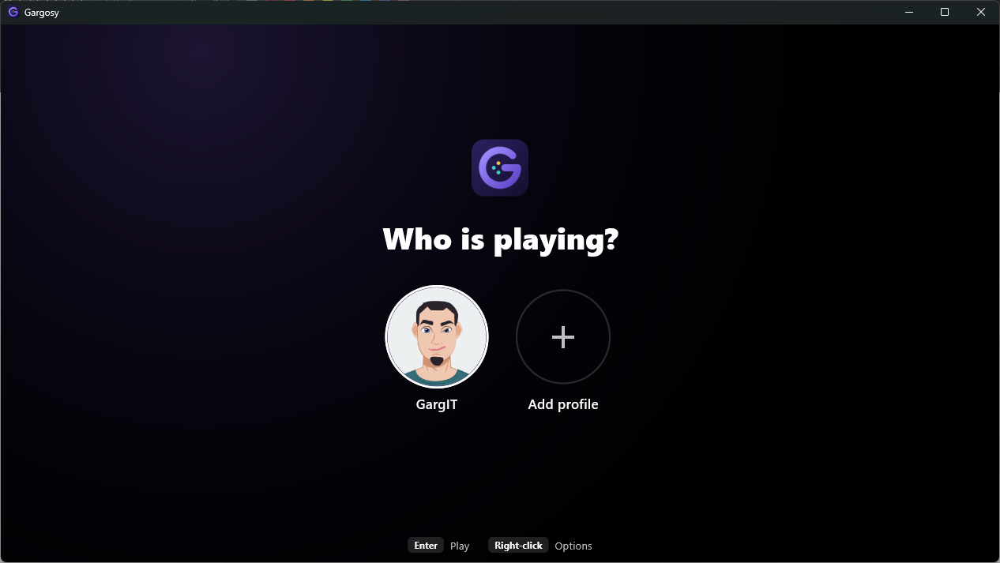
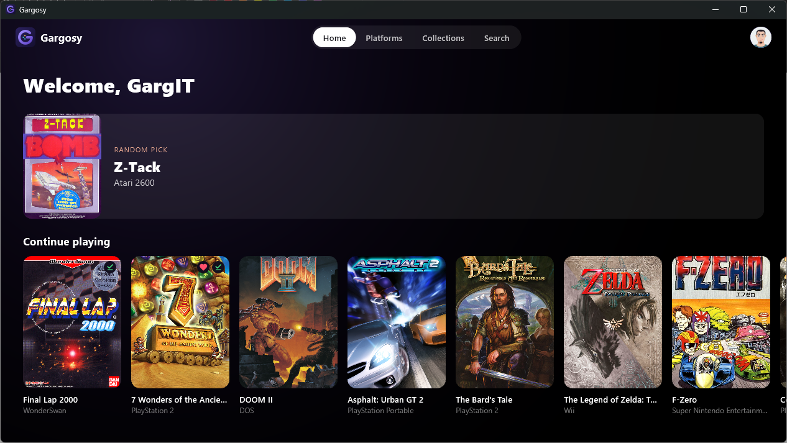
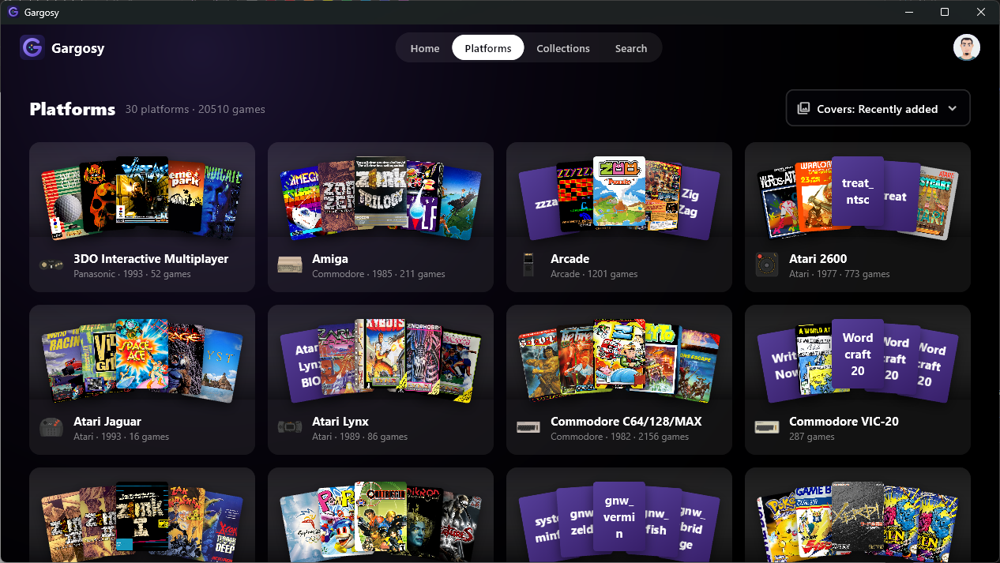
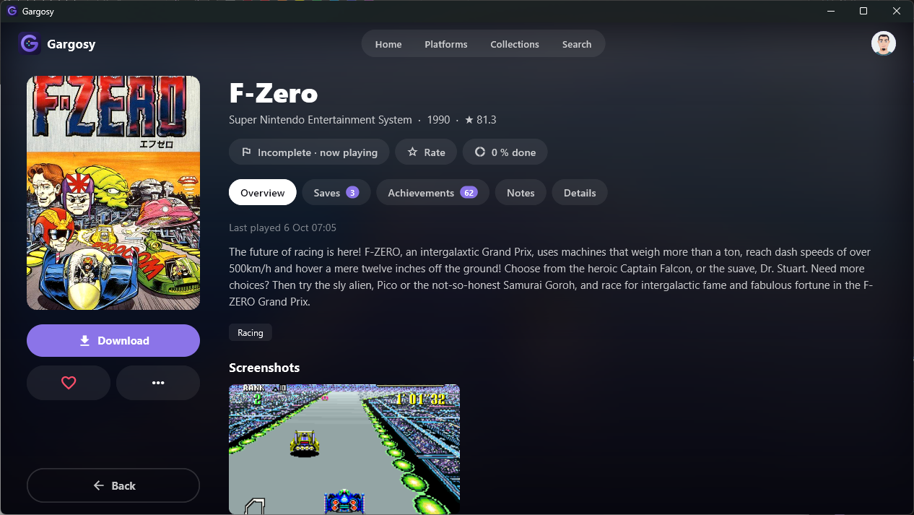
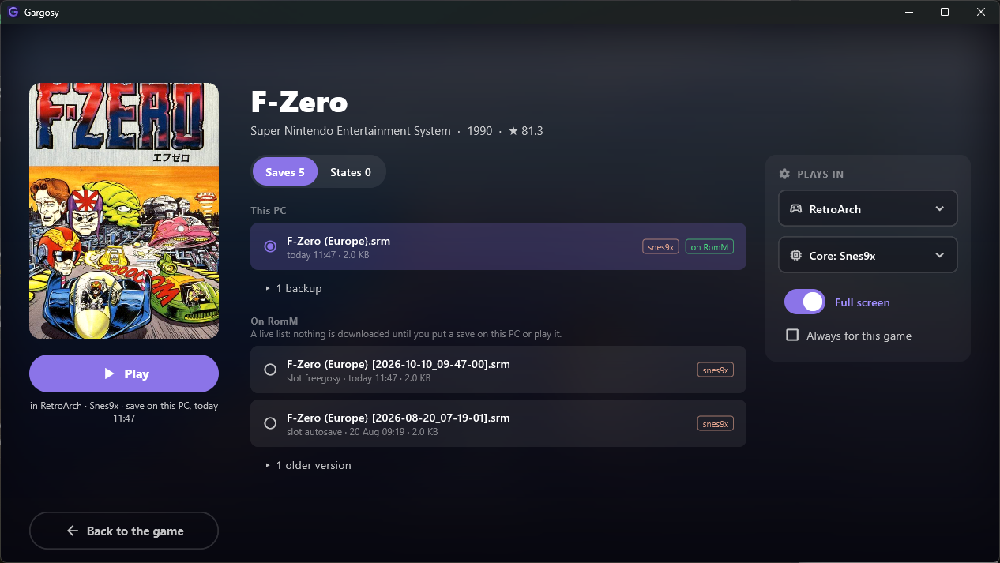

# Gargosy

A RomM client for Windows that looks and feels like RomM's v2 web UI: controller-first,
always portable, with a profile per player. Built on code from
[Freegosy](https://github.com/abduznik/Freegosy) (see `NOTICE.md`).

## Screenshots

**Who is playing?** Pick a profile.



**Home.** A random pick and the games you were playing.



**Platforms.** Each platform with a strip of its covers.



**A game's page.** Status, rating, saves, achievements and notes, as on RomM.



**The play screen.** Choose the save or state and the emulator the game starts with.



## Using it

Unpack `Gargosy-<version>.zip` anywhere you can write (a USB stick works too). The folder holds
everything: the app, `roms\`, `emulators\`, `bios\` and `userdata\`. Nothing goes in AppData.
Download it from [Releases](https://github.com/GargIT/Gargosy/releases); what changed is in
`CHANGELOG.md`. A *preview* of the next version (e.g. `0.2.0-preview.12`) is there too, marked
pre-release: it's rebuilt each time an issue of that version's milestone is done. Take it to try
what's coming; take the latest release for everyday use.

**RomM version.** Gargosy needs RomM 4.8 or newer, and works best with 5.3 or newer (tested on 5.3.1).
Pairing with a phone needs 5.0; before that you log in with username and password. Before 5.3, RomM
doesn't send game ids (disc serials, title ids), so Gargosy reads them from the ROM itself.

Gargosy.exe isn't code-signed, so the first start may show Windows' "Windows protected your PC".
Choose **More info**, then **Run anyway**.

- **Profiles.** Each player adds a profile with their own RomM account (pair with a phone, or
  username and password). A profile's saves, states and emulator settings are its own.
- **PIN.** A profile can have a four-digit PIN. It's a family lock, not security: anyone using
  the same Windows account can open the Gargosy folder.
- **Emulators.** Start → Emulators: download one, or import an install you already have
  (it's copied; your install isn't changed). Put BIOS files in `bios\`.
- **Playing.** On a game's page: Download, then Play. The play screen picks the newest save;
  Y changes the emulator, RB shows the save states.
- **Offline.** Games on this PC still play; saves upload when RomM can be reached again.
- **Another PC.** Copy the folder. Profiles, saves and settings come along; each profile logs
  in again once (the login is encrypted for this PC's Windows user).

## Developing

```
flutter analyze && flutter test
flutter run -d windows -a --root=<a scratch folder>
pwsh tool/make_release.ps1        # dist\Gargosy-<version>.zip
```

`sigil.dll` comes from the `third_party/argosy-sigil` submodule: clone with
`--recurse-submodules`, and run `pwsh tool/build_sigil.ps1` once before `flutter test`.

To release: set the version in `pubspec.yaml`, give its section in `CHANGELOG.md` a date, commit,
then push a tag `v<version>`. The Release workflow tests, builds the zip and publishes it with that
section as the notes.

Previews: closing an issue of a milestone (e.g. `0.2.0`) as completed runs the Preview workflow. It
tests `main`, builds `Gargosy-0.2.0-preview.<run>.zip` and replaces the pre-release `v0.2.0-preview`,
with the milestone's progress and the `[Unreleased]` changelog as notes. It can also be run by hand
from the Actions tab.
